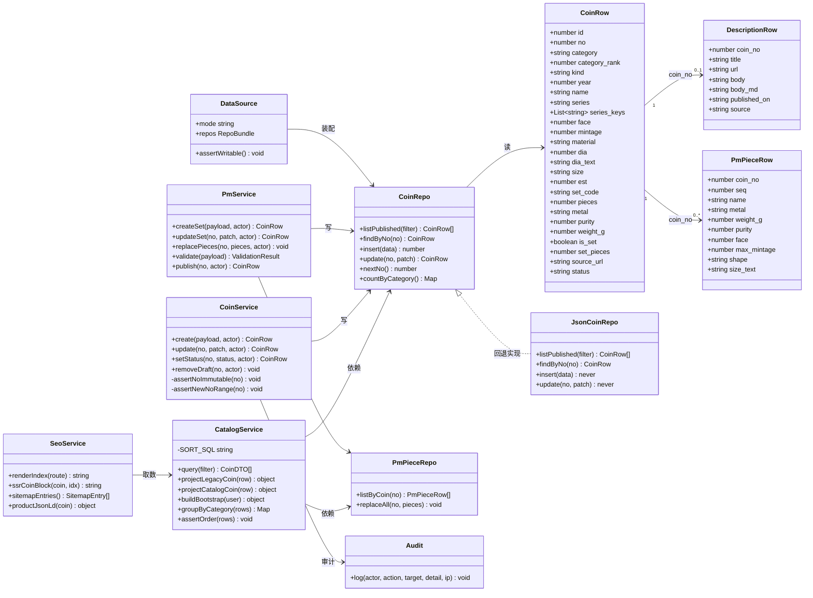
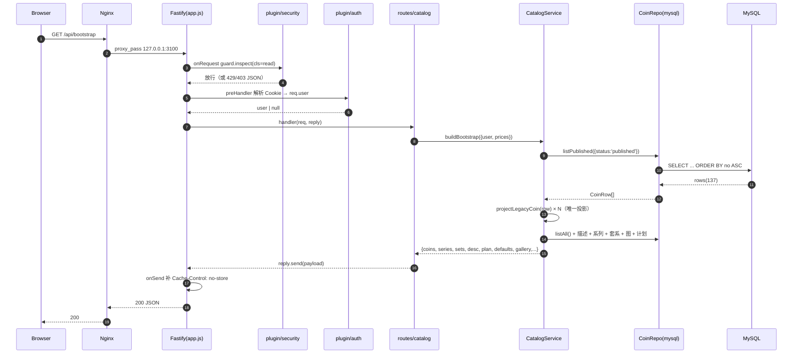
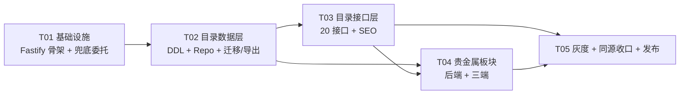

# 藏币录 · 系统架构设计与任务分解（数据入库 + Fastify 分层 + 贵金属板块）

| 项 | 内容 |
|---|---|
| 文档 | 架构设计 + 任务分解（Architect 高见远） |
| 上游 | `prd-db-refactor.md` v1.0、`precious-metal-seed.md`、主理人已拍板 Q1–Q5 |
| 版本 | v1.0 |
| 语言 | 中文 |
| 代码基线 | `server/index.js` 1869 行 / 50 个 (method,path) 处理器 / 5 张 `cl_` 表 / 6 个静态 JSON |
| 目标 | G1 零漂移 · G2 契约零破坏 · G3 贵金属不喧宾夺主 |

> **口径更正（先说清楚，避免验收时对不上）**
> 主理人给的「43 个接口」是按业务路径族的估计。我按 `server/index.js` 逐行点算：**42 个固定路径处理器 + 8 个参数化处理器（4 个路径族 `users/:id`、`users/:id/holdings`、`feedback/:id`、`series/:key`）= 50 个 `(method, path)` 处理器**，另有 1 条蜜罐 `__trap`。本设计**按 50 个处理器逐条给映射**（第 4 节），只多不少；任何一条漏掉都算架构缺陷。

---

# Part A · 系统设计

## 1. 实现思路（Implementation Approach）

### 1.1 核心技术难点

| # | 难点 | 本质 | 对策 |
|---|---|---|---|
| H1 | `no` 是「数组下标 / 图片名 / 路由 / 描述 key / sitemap」五重身份 | 一旦重排，137 个 SEO 页 + 137 张图 + 已收录链接全废 | `id` 自增 PK + `no` UNIQUE 业务主键；**库级触发器 + service 断言**双保险禁改禁删 |
| H2 | 零漂移迁移（137 条逐字段 diff=0） | 现有 JSON 是**不规则**的：`dia` 有 number 也有 `"—"`；`mintage` 有小数（261.5 万）；`thickness/limit/setSize` 等键**部分缺失**而非 null | 列设计区分「数值列 + 文本占位列」；投影函数**可选键缺省不输出**；用 `--verify` 做双向 diff（JSON→DB→JSON） |
| H3 | 换框架但不能破 50 个契约 | 手写 `if` 链一旦整体重写，必然漏分支、改状态码、改错误文案 | **绞杀者模式**：T01 先把老 handler 原样搬进 Fastify 兜底路由，线上可先上线（零行为变化）；T03 再按域逐个替换并跑契约快照 diff |
| H4 | 网站 / 小程序 / 管理端三端同源 | 三套各自排序、各自拼字段，必然分叉 | 排序 SQL 常量 + 投影函数各**唯一一处**；小程序包由 `export:json` 产物打包（间接读 DB，不写第二套查询） |
| H5 | 贵金属不喧宾夺主（≤10%、首屏 0 条） | 28 个规格如果每个都当品种，占比 17% 直接破线 | **以「套」为一个目录单元**（3 行），规格明细进子表 `cl_pm_pieces`；`category_rank=2` 恒排最后 |
| H6 | 灰度可回滚 | DB 出问题时 5 分钟内要能切回 JSON 只读 | `DATA_SOURCE=db\|json` 在 **repository 工厂**这一层切换（不动 route/service）；`export:json` 产物与现有 JSON 同构 |

### 1.2 框架与依赖选型

| 选择 | 理由 |
|---|---|
| **Fastify 4.x**（不是 5.x） | 5.x 要求 Node ≥20，线上 Node 版本未锁定（`engines: >=18`）；4.28 支持 Node 14/16/18/20，风险最低。生态（pino/plugin/hook）完全够用 |
| **不引入 ORM** | PRD 反向目标明确「不引入 ORM 之外的重量级框架」；目录域是 6 张简单表 + 1 张子表，手写 SQL + repository 更可控，也便于把 SQL 锁在一层 |
| **不引入 `@fastify/static`** | 现有静态层有精确的 ETag（`W/"size-mtime"`）、`/img|/assets` 7 天强缓存、`/data/` 403、SPA 回落注入 meta 五件事。自己用 `reply.raw` 复刻 20 行，比对齐插件行为更稳 |
| **不引入 `@fastify/cors`** | 前端同源（网站 `/`、管理端同域）；小程序请求没有 CORS 概念，靠微信域名白名单。加 CORS 只会扩大攻击面 |
| **不引入 `@fastify/rate-limit`** | `server/guard.js` 已有分级桶（`login`/`adminWrite`/`read`/`write`/`static`）+ 蜜罐 + 封禁列表 + `/admin/guard/*` 运维接口，替换会改变 429 文案与阈值 → 违反 G2 |
| **pino 日志关闭** | 现有日志是单行 `ISO METHOD PATH STATUS ms IP`，Supervisor/journal 里照此检索。用 `onResponse` hook 复刻同一行，不启 pino |
| **架构模式** | 分层架构（Route → Service → Repository）+ 插件化横切（`fastify-plugin`）；目录域与用户域**分域演进** |

### 1.3 关键架构决策：分域演进（这是本设计的地基）

现状里 **用户域已经跑在 MySQL 上且工作正常**（`cl_users/cl_holdings/cl_prices/cl_visits`，`store.js` 提供 commit 队列）。把它们一起重写 = 把「能用的东西」放进风险区，收益为零。

因此：

```
┌──────────────────────────── 目录域（本次新建） ────────────────────────────┐
│ coins / descriptions / series / sets / images / plan / pm_pieces           │
│ repository(MySQL) ⇄ repository(JSON 只读)   ← DATA_SOURCE 在这里切         │
└────────────────────────────────────────────────────────────────────────────┘
┌──────────────────────────── 用户域（保持不动） ────────────────────────────┐
│ users / holdings / prices / visits / feedback / reminders / visitors / audit│
│ store.js（commit 队列）→ store-mysql.js（本质就是这 4 张表的 repository）   │
└────────────────────────────────────────────────────────────────────────────┘
```

- `store-mysql.js` 视为用户域的 repository 实现，**内容不改**，仅在文件头补一句职责说明；service 层通过 `account.service.js` 调用它。
- 「路由层不出现 SQL」的验收只看：`server/routes/**` 里没有 `pool.query` / `SELECT` / `INSERT` 字样。用户域本来就没有（SQL 在 store-mysql 里），目录域全在 `repositories/`。

---

## 2. 文件清单（File List）

```
server/
├── index.js                      # ★改为薄壳：require('./app').start()（package.json main 与 Supervisor 命令不变）
├── app.js                        # buildApp()：装配插件、路由、错误处理、关闭钩子
├── config.js                     # 环境变量集中读取 + 默认值 + 启动自检（DATA_SOURCE/STORAGE/端口/DB）
│
├── plugins/
│   ├── db.js                     # fastify-plugin：mysql2 pool，decorate('db')，close hook
│   ├── errors.js                 # setErrorHandler / setNotFoundHandler（{ok:false,error} 与 404 文案对齐）
│   ├── security.js               # onRequest → guard.inspect（分级桶）+ 安全头 + clientIP
│   ├── auth.js                   # decorateRequest('user')，requireLogin / requireAdmin preHandler
│   ├── body.js                   # JSON 解析器：空 body → {}（兼容老前端 POST 不带 body）
│   ├── static.js                 # public/ 托管：ETag、/img 7d、/data 403、SPA 回落
│   └── logging.js                # onResponse 单行访问日志（复刻现有格式）
│
├── routes/
│   ├── index.js                  # registerAll(app)
│   ├── health.js                 # GET /api/health
│   ├── bootstrap.js              # GET /api/bootstrap
│   ├── catalog.js                # GET /api/catalog、GET /api/coin/:no、GET /api/series
│   ├── account.js                # /api/state、/api/holdings*、/api/me/profile、/api/visit、/api/prices
│   ├── auth.js                   # /api/auth/*（含 wx）
│   ├── reminders.js              # /api/reminders ×3
│   ├── feedback.js               # /api/feedback、/api/feature-request
│   ├── seo.js                    # GET /、/all、/series、/plan、/sitemap、/coin/N（HTML 注入）
│   ├── admin/
│   │   ├── index.js              # admin 子路由注册（统一 requireAdmin）
│   │   ├── users.js              # admin/users 一族 7 个
│   │   ├── coins.js              # admin/coins GET/PATCH、admin/coin PATCH
│   │   ├── series.js             # admin/series 一族 6 个 + members
│   │   ├── plan.js               # admin/plan GET/PUT
│   │   ├── images.js             # admin/image POST/DELETE、admin/gallery
│   │   ├── pm.js                 # ★新增：贵金属录入/编辑/上下架/规格明细
│   │   ├── guard.js              # admin/guard/*
│   │   ├── audit.js              # admin/audit
│   │   ├── visitors.js           # admin/visitors、admin/visitors/detail
│   │   └── feedback.js           # admin/feedback 一族 3 个
│   └── legacy.js                 # ★过渡兜底：把 server/legacy/api-handler 挂到未迁移路径（T01 用，T03/T04 后仅剩 __trap）
│
├── legacy/
│   ├── api-handler.js            # 从 index.js 原样裁出的 handleApi(req,res,pathname)（含全部 if 分支）
│   └── page-render.js            # 原样裁出的 renderIndex/ssrCoinBlock/sitemapStaticBlock/TAB_SEO/SX_CSS
│
├── services/
│   ├── catalog.service.js        # ★排序 + 过滤 + 投影的唯一出口（含 buildBootstrap）
│   ├── coin.service.js           # 品种读写：no 断言、draft/publish、字段白名单、审计
│   ├── pm.service.js             # ★贵金属：套+规格明细、必填校验、上下架
│   ├── series.service.js         # 系列 CRUD + listWithCount（替代 server/series.js 的文件实现，接口同名）
│   ├── plan.service.js           # 发行计划读写（整份替换语义）
│   ├── image.service.js          # 上传/删除/多图（落盘 + 表 + gallery_ver bump）
│   ├── seo.service.js            # 页面级 meta / JSON-LD / sitemap 数据源（渲染在 routes/seo.js）
│   ├── account.service.js        # 用户域门面（薄封装 store.js + auth.js）
│   ├── price.service.js          # 行情覆盖（沿用 cl_prices）
│   └── data-source.js            # ★DATA_SOURCE 解析 + 仓储工厂 + 只读模式错误
│
├── repositories/
│   ├── index.js                  # 工厂：按 DATA_SOURCE 返回 mysql 或 json 实现
│   ├── coin.repo.js              # / coin.repo.json.js
│   ├── description.repo.js       # / description.repo.json.js
│   ├── series.repo.js            # / series.repo.json.js
│   ├── set.repo.js               # / set.repo.json.js
│   ├── image.repo.js             # / image.repo.json.js
│   ├── plan.repo.js              # / plan.repo.json.js
│   ├── pm-piece.repo.js          # ★规格明细
│   └── default-holdings.repo.js  # ★coins.json 的 defaults 12 条
│
├── schemas/
│   ├── common.js                 # 通用参数（分页/排序/枚举）+ 错误码文案
│   ├── coin.js                   # 品种字段白名单 + 类型（legacy 可写字段 / 贵金属字段）
│   ├── pm.js                     # ★贵金属必填/条件必填规则
│   ├── auth.js                   # 注册/登录/改密
│   ├── holding.js                # 持仓条目
│   ├── plan.js                   # 年度计划
│   └── admin.js                  # 批量操作 / 分页
│
├── migrations/
│   ├── 001_catalog_core.sql      # cl_coins / cl_coin_descriptions / cl_default_holdings
│   ├── 002_catalog_aux.sql       # cl_series / cl_sets / cl_coin_images / cl_plan_years / cl_plan_doc
│   ├── 003_guards.sql            # no 不可改/不可删触发器 + 视图
│   ├── 004_precious_metal.sql    # cl_pm_pieces
│   └── runner.js                 # 按 cl_schema_migrations 顺序执行，事务 + checksum
│
├── auth.js / guard.js / audit.js / visitors.js / reminders.js / feedback.js / wxsec.js   # 保持不动
├── store.js / store-mysql.js / store-json.js   # 保持不动（用户域）
│
tools/
├── migrate-catalog-to-db.js      # ★JSON → DB（幂等、事务、行数断言、no=i+1）
├── export-json.js                # ★DB → public/data/*.json + data/exports/<ts>/（同构回滚资产）
├── diff-catalog.js               # ★双向逐字段 diff（迁移与导出验收用）
├── build_mp_data.js              # 改造：读 export 产物，补 category/pm 字段，体积守卫
├── gen-sitemap.js                # 改造：读 export 产物，PM 追加 priority 0.5
└── api-snapshot.js               # ★50 接口 + 141 URL 的响应快照/对比（G2 验收器）

data/
├── seeds/precious-metal-2026.json   # ★3 套贵金属种子（来自 precious-metal-seed.md）
└── exports/                         # export:json 的时间戳快照（回滚资产 + 小程序打包源）

admin/src/
├── api/endpoints.js                 # +pmApi
├── pages/PreciousMetal.vue          # ★贵金属录入/列表
├── components/PmForm.vue            # ★字段分组表单（材质/成色/克重/发行方式/规格明细）
└── router/index.js                  # +/pm 路由

tests/
├── contract-smoke.test.js           # 50 接口状态码 + 顶层键名断言
├── catalog-migrate.test.js          # 迁移幂等 / 行数 / diff
└── pm-rules.test.js                 # 贵金属必填与上架规则

docs/
└── deploy-db-refactor.md            # 灰度切换与回滚 Runbook
```

---

## 3. 数据结构与接口（Data Structures and Interfaces）

### 3.1 MySQL DDL

> 统一 `cl_` 前缀（沿用现有 5 表）。所有时间 `DATETIME(3)`、UTC；所有金额/克重 `DECIMAL`；`decimalNumbers:true` 已在连接串里（`store-mysql.js` 同款配置）。

#### 001_catalog_core.sql

```sql
-- 品种主表：一行 = 一个「目录单元」（普通币/钞一枚，贵金属一「套」）
CREATE TABLE IF NOT EXISTS cl_coins (
  id            BIGINT UNSIGNED NOT NULL AUTO_INCREMENT,
  no            INT UNSIGNED    NOT NULL COMMENT '对外序号 = 旧 i+1。一等身份，UNIQUE，1..137 永久锁定',
  category      ENUM('commemorative_coin','commemorative_note','precious_metal')
                                NOT NULL DEFAULT 'commemorative_coin',
  category_rank TINYINT UNSIGNED NOT NULL DEFAULT 0
                                COMMENT '排序权重 0=普通币 1=纪念钞 2=贵金属；由 service 与 category 同步写',
  kind          ENUM('coin','note') NOT NULL DEFAULT 'coin' COMMENT 'legacy 兼容字段，贵金属写 coin',
  year          SMALLINT UNSIGNED NOT NULL,
  name          VARCHAR(128)    NOT NULL,
  series        VARCHAR(16)     NOT NULL DEFAULT '' COMMENT '主系列 key（可为空串）',
  series_keys   JSON            NULL COMMENT '多系列；NULL 时投影回落 [series]',
  face          DECIMAL(10,2)   NOT NULL DEFAULT 0 COMMENT '面额（元）',
  mintage       DECIMAL(12,2)   NULL COMMENT '万枚/万张；旧数据含 261.5 这类小数。贵金属「套」无单一发行量→NULL，逐枚见 cl_pm_pieces.max_mintage',
  mintage_note  VARCHAR(64)     NULL,
  material      VARCHAR(32)     NOT NULL DEFAULT '' COMMENT '展示文本（金质/铜镍合金…）',
  dia           DECIMAL(6,1)    NULL COMMENT '直径数值；纪念钞与贵金属按需留空',
  dia_text      VARCHAR(8)      NULL COMMENT '非数值占位（旧数据的 "—"）',
  size          VARCHAR(16)     NULL COMMENT '纪念钞票幅 165×80',
  thickness     VARCHAR(16)     NULL,
  weight        VARCHAR(16)     NULL COMMENT 'legacy 展示文本 9.32克；结构化看 weight_g',
  caster        VARCHAR(64)     NULL,
  edge          VARCHAR(32)     NULL,
  obverse       TEXT            NULL,
  reverse       TEXT            NULL,
  spec_from     VARCHAR(64)     NULL COMMENT '旧字段 specFrom：参数是否推定',
  est           DECIMAL(12,2)   NULL COMMENT '参考估值，非交易价；贵金属恒为 NULL',
  set_code      VARCHAR(32)     NOT NULL DEFAULT 'single',
  pieces        SMALLINT UNSIGNED NOT NULL DEFAULT 1,
  set_size      SMALLINT UNSIGNED NULL,
  limit_qty     SMALLINT UNSIGNED NULL,
  reserve_limit SMALLINT UNSIGNED NULL,
  /* ---- 贵金属结构化字段（普通币钞全 NULL） ---- */
  metal         ENUM('gold','silver','platinum','bimetal','mixed') NULL COMMENT 'mixed=套内多材质，真实值看 cl_pm_pieces',
  purity        DECIMAL(5,3)    NULL COMMENT '0.999',
  weight_g      DECIMAL(10,2)   NULL COMMENT '单枚克重；is_set=1 时改用 set_weight_g',
  spec          VARCHAR(64)     NULL COMMENT '规格/尺寸/精制等展示描述',
  shape         ENUM('round','plum','rhombus','other') NULL,
  quality       ENUM('proof','uncirculated') NULL,
  issue_method  ENUM('reservation','lottery','direct_sale','unknown') NULL,
  issue_date    DATE            NULL,
  is_set        TINYINT(1)      NOT NULL DEFAULT 0,
  set_pieces    SMALLINT UNSIGNED NULL COMMENT 'is_set=1 必填',
  set_weight_g  DECIMAL(10,2)   NULL,
  set_face_total DECIMAL(12,2)  NULL,
  sales_channel VARCHAR(64)     NULL,
  dealer        VARCHAR(64)     NULL,
  certificate   VARCHAR(64)     NULL,
  packaging     VARCHAR(64)     NULL,
  /* ---- 来源与状态 ---- */
  source_url    VARCHAR(255)    NOT NULL DEFAULT '' COMMENT '存量 137 条以 legacy:coins.json 占位',
  source_text   VARCHAR(255)    NULL,
  source_date   DATE            NULL,
  verified      TINYINT(1)      NOT NULL DEFAULT 0,
  status        ENUM('draft','published') NOT NULL DEFAULT 'published',
  created_at    DATETIME(3)     NOT NULL DEFAULT CURRENT_TIMESTAMP(3),
  updated_at    DATETIME(3)     NOT NULL DEFAULT CURRENT_TIMESTAMP(3) ON UPDATE CURRENT_TIMESTAMP(3),
  PRIMARY KEY (id),
  UNIQUE KEY uk_no (no),
  KEY idx_cat_sort (category_rank, year, no),
  KEY idx_series (series),
  KEY idx_status (status),
  KEY idx_year (year)
) ENGINE=InnoDB DEFAULT CHARSET=utf8mb4 COMMENT='品种目录单一事实源（no 为业务主键）';

-- 品种描述（原 descriptions.json，128 条，9 个品种无描述属正常）
CREATE TABLE IF NOT EXISTS cl_coin_descriptions (
  coin_no      INT UNSIGNED    NOT NULL,
  title        VARCHAR(255)    NOT NULL DEFAULT '',
  url          VARCHAR(255)    NULL,
  body         MEDIUMTEXT      NOT NULL COMMENT '原 text',
  body_md      MEDIUMTEXT      NULL COMMENT '原 textMd',
  published_on DATE            NULL COMMENT '原 date',
  source       VARCHAR(32)     NULL COMMENT '原 source（baike / 空）',
  updated_at   DATETIME(3)     NOT NULL DEFAULT CURRENT_TIMESTAMP(3) ON UPDATE CURRENT_TIMESTAMP(3),
  PRIMARY KEY (coin_no),
  CONSTRAINT fk_desc_coin FOREIGN KEY (coin_no) REFERENCES cl_coins (no)
    ON DELETE RESTRICT ON UPDATE RESTRICT
) ENGINE=InnoDB DEFAULT CHARSET=utf8mb4 COMMENT='央行公告原文/百科介绍，按 no 一对一';

-- 新账号的初始藏品模板（coins.json 的 defaults，12 条；bootstrap 必须原样下发）
CREATE TABLE IF NOT EXISTS cl_default_holdings (
  ord     SMALLINT UNSIGNED NOT NULL,
  name    VARCHAR(64)       NOT NULL,
  rolls   INT               NOT NULL DEFAULT 0,
  cost    DECIMAL(12,2)     NOT NULL DEFAULT 0,
  market  DECIMAL(12,2)     NOT NULL DEFAULT 0,
  grp     VARCHAR(32)       NOT NULL DEFAULT '独立藏品',
  sep     TINYINT(1)        NOT NULL DEFAULT 0,
  PRIMARY KEY (ord)
) ENGINE=InnoDB DEFAULT CHARSET=utf8mb4 COMMENT='新用户初始藏品模板';
```

#### 002_catalog_aux.sql

```sql
CREATE TABLE IF NOT EXISTS cl_series (
  series_key VARCHAR(16)  NOT NULL,
  name       VARCHAR(32)  NOT NULL,
  descr      VARCHAR(255) NOT NULL DEFAULT '',
  img        VARCHAR(160) NOT NULL DEFAULT '',
  img_from   VARCHAR(16)  NULL,
  sort       SMALLINT     NOT NULL DEFAULT 0,
  PRIMARY KEY (series_key)
) ENGINE=InnoDB DEFAULT CHARSET=utf8mb4 COMMENT='系列主数据（20 条，仅元信息；成员靠 cl_coins.series_keys）';

CREATE TABLE IF NOT EXISTS cl_sets (
  set_code VARCHAR(32)         NOT NULL,
  name     VARCHAR(64)         NOT NULL,
  unit     VARCHAR(8)          NOT NULL DEFAULT '枚',
  total    SMALLINT UNSIGNED   NOT NULL DEFAULT 0,
  members  SMALLINT UNSIGNED   NOT NULL DEFAULT 0,
  size     SMALLINT UNSIGNED   NULL COMMENT '每卷/每刀枚数',
  kind     VARCHAR(16)         NULL COMMENT 'roll 等',
  PRIMARY KEY (set_code)
) ENGINE=InnoDB DEFAULT CHARSET=utf8mb4 COMMENT='普通币套系（21 条）。贵金属套装不复用此表';

CREATE TABLE IF NOT EXISTS cl_coin_images (
  coin_no  INT UNSIGNED NOT NULL,
  kind     ENUM('main','obverse','reverse','set') NOT NULL,
  filename VARCHAR(64)  NOT NULL,
  is_mock  TINYINT(1)   NOT NULL DEFAULT 0 COMMENT '1=占位图（旧 34/56）',
  ord      TINYINT UNSIGNED NOT NULL DEFAULT 0,
  PRIMARY KEY (coin_no, kind),
  KEY idx_kind (kind),
  CONSTRAINT fk_img_coin FOREIGN KEY (coin_no) REFERENCES cl_coins (no)
    ON DELETE RESTRICT ON UPDATE RESTRICT
) ENGINE=InnoDB DEFAULT CHARSET=utf8mb4 COMMENT='品种多图；images.json 的 real/mock 由 is_mock 派生';

CREATE TABLE IF NOT EXISTS cl_plan_years (
  year         SMALLINT UNSIGNED NOT NULL,
  published_at DATE     NULL,
  published_by VARCHAR(64) NULL,
  source_url   VARCHAR(255) NULL,
  source_text  TEXT     NULL,
  items        JSON     NOT NULL COMMENT '年度条目原样存 JSON：字段异质（extra/banks/design…），拆列必漂移',
  ord          TINYINT UNSIGNED NOT NULL DEFAULT 0,
  PRIMARY KEY (year)
) ENGINE=InnoDB DEFAULT CHARSET=utf8mb4 COMMENT='央行年度发行计划（整份替换语义，只增普通币/钞，永不含贵金属）';

CREATE TABLE IF NOT EXISTS cl_plan_doc (
  id      TINYINT UNSIGNED NOT NULL DEFAULT 1,
  updated DATE     NULL,
  note    TEXT     NULL,
  PRIMARY KEY (id)
) ENGINE=InnoDB DEFAULT CHARSET=utf8mb4 COMMENT='计划文档级元信息（1 行）';

CREATE TABLE IF NOT EXISTS cl_schema_migrations (
  version    VARCHAR(32) NOT NULL,
  checksum   CHAR(64)    NOT NULL,
  applied_at DATETIME(3) NOT NULL DEFAULT CURRENT_TIMESTAMP(3),
  PRIMARY KEY (version)
) ENGINE=InnoDB DEFAULT CHARSET=utf8mb4;
```

#### 003_guards.sql（保号红线的**库级**落地）

```sql
DROP TRIGGER IF EXISTS trg_cl_coins_no_immutable;
CREATE TRIGGER trg_cl_coins_no_immutable BEFORE UPDATE ON cl_coins
FOR EACH ROW
BEGIN
  IF NEW.no <> OLD.no THEN
    SIGNAL SQLSTATE '45000' SET MESSAGE_TEXT = 'cl_coins.no 禁止修改（保号红线：路由/图片/SEO 全错位）';
  END IF;
  IF NEW.id <> OLD.id THEN
    SIGNAL SQLSTATE '45000' SET MESSAGE_TEXT = 'cl_coins.id 禁止修改';
  END IF;
  IF OLD.no <= 137 AND NEW.category <> OLD.category THEN
    SIGNAL SQLSTATE '45000' SET MESSAGE_TEXT = '已发布品种的 category 禁止变更（排序与分类口径会漂移）';
  END IF;
END;

DROP TRIGGER IF EXISTS trg_cl_coins_legacy_delete;
CREATE TRIGGER trg_cl_coins_legacy_delete BEFORE DELETE ON cl_coins
FOR EACH ROW
BEGIN
  IF OLD.no <= 137 THEN
    SIGNAL SQLSTATE '45000' SET MESSAGE_TEXT = '已发布品种 1..137 禁止删除（只允许下架 status=draft 之外的新品种）';
  END IF;
END;
```

> **双保险**：触发器是最后一道闸；`coin.service.js` 在写入前再做一次断言（`assertNoImmutable(no)`），错误直接 400 + 中文文案，管理端能就地提示，不用等 SQL 报 45000。
> **137 这个常量**写在触发器里是刻意的：它是「历史已收录边界」，不是可配置项。若将来真要动，必须走「新增迁移 + 全站 301 映射」的专项，不在本次范围。

> **迁移文件切分约定（工程实现必读）**
> 触发器体里有 `;`，`mysql2` 一旦开 `multipleStatements` 就会被拆断，而 `DELIMITER` 是 mysql CLI 语法、驱动不认。因此：
> ① 迁移文件**不用** `DELIMITER`；② 语句之间用独立行 `-- @@` 分隔；③ `runner.js` 按 `-- @@` 切块，**每块整段** `conn.query(chunk)` 发送（服务端会把整段当一个语句解析，`BEGIN...END` 内的分号安全）；④ 全程 `multipleStatements: false`。
> 这样 `001/002/004` 的普通 DDL 与 `003` 的触发器都能用同一套 runner。

#### 004_precious_metal.sql

```sql
-- 贵金属套内规格明细：一套 15 枚就有 15 行，各自克重/面额/发行量都不同
CREATE TABLE IF NOT EXISTS cl_pm_pieces (
  coin_no     INT UNSIGNED NOT NULL COMMENT '所属套的 cl_coins.no',
  seq         TINYINT UNSIGNED NOT NULL COMMENT '套内序号 1..n，按公告顺序',
  name        VARCHAR(64)  NOT NULL,
  metal       ENUM('gold','silver','platinum','bimetal') NOT NULL,
  weight_g    DECIMAL(10,2) NOT NULL,
  purity      DECIMAL(5,3)  NOT NULL,
  face        DECIMAL(10,2) NOT NULL,
  max_mintage INT UNSIGNED NOT NULL,
  shape       ENUM('round','plum','rhombus','other') NOT NULL DEFAULT 'round',
  size_text   VARCHAR(32)  NULL COMMENT '⌀32mm / 外接⌀100mm / 边长 23mm',
  quality     ENUM('proof','uncirculated') NULL,
  reverse_text VARCHAR(255) NULL COMMENT '背面图案',
  PRIMARY KEY (coin_no, seq),
  CONSTRAINT fk_piece_coin FOREIGN KEY (coin_no) REFERENCES cl_coins (no)
    ON DELETE CASCADE ON UPDATE RESTRICT
) ENGINE=InnoDB DEFAULT CHARSET=utf8mb4 COMMENT='贵金属套内每一枚的规格（只读参考，不参与成本折算）';
```

### 3.2 零漂移的字段映射（迁移与投影的唯一依据）

| 旧 JSON 字段 | 新列 | 投影规则（必须逐字复刻） |
|---|---|---|
| `i` | —（派生） | `i = no - 1`，**number** |
| `year` | `year` | `Number()` |
| `face` | `face` | `Number()`（0.1 必须还是 0.1） |
| `mintage` | `mintage` | `Number()`，**DECIMAL 而非 INT**（261.5 不能变 262） |
| `dia` | `dia` / `dia_text` | `dia != null ? Number(dia) : (dia_text ?? '—')`；钞的 `"—"` 存 `dia_text` |
| `size` | `size` | 非空才输出（10 条钞有，其余**无此键**） |
| `set` | `set_code` | 原样 |
| `seriesKeys` | `series_keys` | JSON 数组；`NULL` → `[series]`（旧数据 137 条全有，等价） |
| `thickness/weight/caster/edge/obverse/reverse` | 同名 | **非空才输出**（126/106 条有，其余无键） |
| `limit/reserveLimit/setSize/specFrom` | `limit_qty/reserve_limit/set_size/spec_from` | 非空才输出 |
| `est` | `est` | 存量 137 条全有（`Number()`）；贵金属恒 `NULL`，且投影对 `precious_metal` **不输出 `est` 键**（见 6.4），`hasPrice:false` |
| `defaults[12]` | `cl_default_holdings` | `{name,rolls,cost,market,group,sep}` 原样 |
| `meta.count(135)` | — | 导出的 `meta.count` 写真实 137（唯一有意差异，前端不读它；`renderIndex` 用 `coins.length`） |

**投影函数签名（唯一实现，禁止复制）**

```js
// services/catalog.service.js
function projectLegacyCoin(row): {
  i:number, year:number, name:string, series:string, face:number, mintage:number,
  material:string, dia:number|string, kind:'coin'|'note', est:number, set:string,
  pieces:number, thickness?:string, weight?:string, caster?:string, edge?:string,
  obverse?:string, reverse?:string, seriesKeys:string[],
  size?:string, limit?:number, reserveLimit?:number, setSize?:number, specFrom?:string,
  // ↓ 仅「允许新增」的字段，老前端不读
  no:number, category:string, status:'published'|'draft'
}
```

> 键顺序按上表顺序输出（与现 `coins.json` 一致），这样连 `JSON.stringify` 的字符串 diff 都能过；`tools/diff-catalog.js` 同时做「深比较」和「键序比较」两种模式。

### 3.3 类图

见 `class-diagram.mermaid`（同内容内嵌）：



### 3.4 请求流转时序图

独立文件（可直接粘进 mermaid 渲染器）：
`sequence-diagram.mermaid`（读路径 bootstrap）· `sequence-pm-write.mermaid`（贵金属写入/上架）· `sequence-datasource.mermaid`（灰度开关启动）。
同内容内嵌如下：



```mermaid
sequenceDiagram
  autonumber
  participant AD as Admin UI
  participant R as routes/admin/coins
  participant CS as CoinService
  participant CR as CoinRepo
  participant DB as MySQL
  participant AU as Audit

  AD->>R: PATCH /api/admin/coin {id, patch}
  R->>R: requireAdmin()
  R->>CS: update(no, patch, actor)
  CS->>CS: assertNoImmutable(no)
  alt patch 含 no / category / id
    CS-->>R: 400 {ok:false, error:'no 不允许修改'}
  else 合法
    CS->>CS: pick(patch, WRITABLE_FIELDS) 白名单
    CS->>CR: update(no, clean)
    CR->>DB: BEGIN; UPDATE cl_coins SET ... WHERE no=?; COMMIT
    alt 触发器拦截
      DB-->>CR: SQLSTATE 45000
      CR-->>CS: throw
      CS-->>R: 409 {ok:false, error:'保号红线'}
    else 成功
      DB-->>CR: row
      CR-->>CS: CoinRow
      CS->>AU: log(actor,'coin.update',no,applied,ip)
      CS->>CS: bumpCatalogRev()（60s 缓存失效）
      CS-->>R: CoinRow → projectLegacyCoin + 贵金属字段
      R-->>AD: 200 {ok:true, coin, applied}
    end
  end
```

---

## 4. 接口兼容映射表（50 个处理器，逐条）

图例：**不变** = 路径/方法/状态码/顶层结构完全一致；**加字段** = 只允许新增键。

### 4.1 公共与目录（23）

| # | 方法与路径 | 旧行 | 新路由文件 | 新 service | 兼容性 |
|---|---|---|---|---|---|
| 1 | GET `/api/health` | 815 | `routes/health.js` | `catalog.service`, `account.service` | 不变；`coins` 改为 published 计数（137），可加 `catalog` 子对象 |
| 2 | GET `/api/bootstrap` | 826 | `routes/bootstrap.js` | `catalog.service.buildBootstrap` | **不变**：`coins` 顺序保持 `no ASC`；每项可加 `no/category/status` |
| 3 | GET `/api/state` | 883 | `routes/account.js` | `account.service` | 不变 |
| 4 | GET `/api/series` | 1490 | `routes/catalog.js` | `series.service.listWithCount` | 不变（20 项 + count） |
| 5 | PUT `/api/prices` | 1134 | `routes/account.js` | `price.service` | 不变；上限校验由 `coins.length` 改为 `max(no)` |
| 6 | PUT `/api/holdings` | 1111 | `routes/account.js` | `account.service` | 不变（含 300 条上限、未知品种报错文案） |
| 7 | POST `/api/holdings/reset` | 1123 | `routes/account.js` | `account.service` | 不变；`defaults` 改读 `cl_default_holdings` |
| 8 | POST `/api/me/profile` | 833 | `routes/account.js` | `account.service` + `wxsec` | 不变（6MB bodyLimit 必须按路由覆写） |
| 9 | POST `/api/feature-request` | 1392 | `routes/feedback.js` | `feedback`（原模块） | 不变 |
| 10 | POST `/api/feedback` | 1416 | `routes/feedback.js` | `feedback` | 不变 |
| 11 | GET `/api/reminders` | 1324 | `routes/reminders.js` | `reminders` | 不变（`templateId/wxBound/list`） |
| 12 | POST `/api/reminders` | 1335 | 同上 | `reminders` | 不变 |
| 13 | DELETE `/api/reminders` | 1355 | 同上 | `reminders` | 不变 |
| 14 | POST `/api/visit` | 898 | `routes/account.js` | `visitors` + `account.service` | 不变（`{ok,total,today}`） |
| 15 | GET `/api/visit` | 930 | 同上 | 同上 | 不变 |
| 16 | GET `/api/auth/me` | 937 | `routes/auth.js` | `auth` | 不变 |
| 17 | POST `/api/auth/register` | 942 | 同上 | `auth` | 不变（429 上限、409 重名） |
| 18 | POST `/api/auth/login` | 971 | 同上 | `auth` + `guard` | 不变（失败计数、Set-Cookie） |
| 19 | POST `/api/auth/logout` | 1086 | 同上 | `auth` | 不变 |
| 20 | POST `/api/auth/password` | 1091 | 同上 | `auth` | 不变 |
| 21 | POST `/api/auth/wx/login` | 997 | 同上 | `auth` + `wxsec` | 不变（openid 绑定/建号） |
| 22 | POST `/api/auth/wx/bind` | 1051 | 同上 | `auth` | 不变 |
| 23 | POST `/api/auth/wx/unbind` | 1076 | 同上 | `auth` | 不变 |

### 4.2 管理端（27）

| # | 方法与路径 | 旧行 | 新路由文件 | 新 service | 兼容性 |
|---|---|---|---|---|---|
| 24 | GET `/api/admin/guard/bans` | 1157 | `admin/guard.js` | `guard` | 不变 |
| 25 | POST `/api/admin/guard/unban` | 1163 | 同上 | `guard` | 不变 |
| 26 | GET `/api/admin/users` | 1177 | `admin/users.js` | `account.service` | 不变（`users/total/page/size/stats`） |
| 27 | GET `/api/admin/users/:id/holdings` | 1226 | 同上 | 同上 | 不变 |
| 28 | GET `/api/admin/users/:id` | 1236 | 同上 | 同上 | 不变 |
| 29 | PATCH `/api/admin/users/:id` | 1272 | 同上 | 同上 | 不变（自我保护/至少一个管理员） |
| 30 | DELETE `/api/admin/users/:id` | 1300 | 同上 | 同上 | 不变 |
| 31 | POST `/api/admin/users/batch` | 1251 | 同上 | 同上 | 不变（100 条上限、`{affected}`） |
| 32 | GET `/api/admin/audit` | 1220 | `admin/audit.js` | `audit` | 不变（`audit.query` 原样） |
| 33 | GET `/api/admin/visitors` | 1368 | `admin/visitors.js` | `visitors` | 不变 |
| 34 | GET `/api/admin/visitors/detail` | 1379 | 同上 | `visitors` | 不变 |
| 35 | GET `/api/admin/feedback` | 1459 | `admin/feedback.js` | `feedback` | 不变 |
| 36 | PATCH `/api/admin/feedback/:id` | 1475 | 同上 | `feedback` | 不变 |
| 37 | DELETE `/api/admin/feedback/:id` | 1478 | 同上 | `feedback` | 不变 |
| 38 | GET `/api/admin/plan` | 1496 | `admin/plan.js` | `plan.service` | 不变（`{ok,plan}`） |
| 39 | PUT `/api/admin/plan` | 1502 | 同上 | `plan.service` | 不变（整份替换、`{ok,years,items}`） |
| 40 | POST `/api/admin/series/members` | 1519 | `admin/series.js` | `series.service` | 不变（含主系列回填语义） |
| 41 | POST `/api/admin/series` | 1556 | 同上 | `series.service` | 不变（key 校验文案） |
| 42 | POST `/api/admin/series/image` | 1567 | 同上 | `series.service` | 不变（返回 `img/items`） |
| 43 | PATCH `/api/admin/series/:key` | 1580 | 同上 | `series.service` | 不变 |
| 44 | DELETE `/api/admin/series/:key` | 1591 | 同上 | `series.service` | 不变（`{touched}`） |
| 45 | GET `/api/admin/coins` | 1603 | `admin/coins.js` | `catalog.service` | 不变（`coins/series/sets/gallery`）；每项加 `no/category/status` |
| 46 | PATCH `/api/admin/coins` | 1610 | 同上 | `coin.service` | 不变（`{saved,failed[{id,error}]}`、300 条上限） |
| 47 | PATCH `/api/admin/coin` | 1635 | 同上 | `coin.service` | 不变（`{ok,coin,applied}`）；`applied` 可含新字段 |
| 48 | POST `/api/admin/gallery` | 1684 | `admin/images.js` | `image.service` | 不变（kind 白名单、文件存在校验、`{images}`） |
| 49 | POST `/api/admin/image` | 1705 | 同上 | `image.service` | 不变（`{file,images}`；6MB bodyLimit + 缩略图 480/160） |
| 50 | DELETE `/api/admin/image` | 1747 | 同上 | `image.service` | 不变（query `id&kind`，清 th/th/s） |
| — | ANY `/api/__trap` | 1770 | `routes/legacy.js` | `guard.trap` | 保持 404 + `{ok:false,error:'接口不存在'}` |

**未匹配 `/api/*` 兜底**：`setNotFoundHandler` 必须返回 `404 {"ok":false,"error":"接口不存在"}`（与现状逐字一致），不能是 Fastify 默认的 `{"message":"Route ... not found"}`。

### 4.3 允许新增的接口（只增不改，G2 安全）

| 方法与路径 | 用途 | 说明 |
|---|---|---|
| GET `/api/catalog?category=&year=&series=&status=&page=&size=` | 三端统一目录出参 | 排序唯一实现；`category` 取 `coin\|note\|pm\|all`（默认 `all` 但保持服务端排序）；公开只返回 `published` |
| GET `/api/coin/:no` | 单品种完整出参（含描述/多图/规格明细） | 详情页与小程序 detail 用 |
| GET `/api/admin/pm?status=` | 贵金属列表（含 draft） | 管理端 |
| POST `/api/admin/pm` | 新建贵金属（默认 draft） | P1-1 字段级错误 `{ok:false,error,field}` |
| PATCH `/api/admin/pm/:no` | 编辑贵金属 | 同 `admin/coin` 白名单 + PM 字段 |
| PUT `/api/admin/pm/:no/pieces` | 整份替换套内规格 | 事务：DELETE + INSERT |
| POST `/api/admin/pm/:no/status` | 上下架 | `{status:'draft'\|'published'}` |
| DELETE `/api/admin/pm/:no` | 删除草稿 | 仅 `no>=138 且 status=draft`；触发器兜底 |

---

## 5. 迁移方案（Migration）

### 5.1 `tools/migrate-catalog-to-db.js`

```
--dry-run（默认） → 只校验不写
--apply          → 事务写入
--verify         → 写后导出到临时目录，与源 JSON 逐字段 diff
--force          → 库内已有 catalog.seed_rev 时允许重跑（仍走幂等 upsert）
```

执行序列（单事务，InnoDB）：

1. **前置断言（任一失败即中止，不写一行）**
   - `coins.length === 137`，`i` 为 `0..136` 连续且 `i === idx`
   - `descriptions` key 数 `=== 128`，缺失集合 `⊆ {19,26,38,59,86,87,101,130,136}`
   - `series` key 数 `=== 19`，`series.json.items.length === 20`
   - `sets` `=== 21`；`gallery.coins` key `=== 137`；`images.real === 135`，`mock == [34,56]`
   - `plan.years.length === 2`（当前值；写成「≥1 且 total items === 10」更稳）
   - `defaults.length === 12`
   - 文件 sha256 → 记入 `cl_meta['catalog.source_sha256']`
2. **建表**：调用 `migrations/runner.js`（`001..004`，跳过已应用版本，校验 checksum）
3. **写入**（顺序受外键约束支配）
   `cl_coins`（`no = i+1`，`category` 由 `kind` 推导，`category_rank` 同写，`status='published'`，`source_url='legacy:public/data/coins.json'`，`verified=0`）
   → `cl_default_holdings`
   → `cl_series`（20）→ `cl_sets`（21）→ `cl_coin_descriptions`（128，跳过 9 个缺项）
   → `cl_coin_images`（250 张，`is_mock = mock.includes(no)`）
   → `cl_plan_doc` + `cl_plan_years`（`items` 原样 JSON）
4. **逐表行数断言**：`137 / 12 / 20 / 21 / 128 / 250 / 2 / 137`
5. **回写元信息**：`cl_meta['catalog.seed_rev'] = Date.now()`、`catalog.gallery_ver`
6. **`--verify`**：调用 `export-json` 到临时目录 → `diff-catalog` 与源文件比对 → 0 差异才 commit（`--apply` 时先写临时库再切？否：本库数据量极小，直接事务内完成，失败 rollback 即可）

**幂等保证**：所有写入用 `INSERT ... ON DUPLICATE KEY UPDATE`；`cl_coins` 冲突键是 `no`，额外断言「同 `no` 的 `name` 必须一致」，不一致则报错而不是覆盖（防止把人工改过的品种用旧 JSON 冲掉）。

**禁止重排的落地三层**：
1. `no = i + 1` 原样写入，不依赖任何排序；
2. 迁移只 INSERT/UPDATE，没有任何 `DELETE FROM cl_coins`；
3. 触发器 + service 断言（见 003_guards.sql）。

### 5.2 `npm run export:json`（回滚资产）

```
node tools/export-json.js            # 写 public/data/*.json（tmp+rename 原子替换）+ data/exports/<ISO>/ 快照
node tools/export-json.js --out DIR  # 只写指定目录（迁移验收/小程序打包用）
```

- 产物 6 个文件 + `defaults`，结构与现有**完全同构**（键名/嵌套/类型一致），唯一有意差异：`meta.count` 写真实品种数。
- `cl_coin_images.is_mock` → `images.json` 的 `real[] / mock[]`；`gallery.json` 结构 `{updated, coins:{no:[{f,k}]}}` 原样还原。
- `plan.json` = `{updated, note, years:[{year,publishedAt,publishedBy,sourceUrl,sourceText,items:[...]}]}`，`items` 直接取 JSON 列，字段异质也不丢。
- 导出后自动跑一次 `diff-catalog --src public/data --orig data/exports/baseline`（首轮基线先手工 `cp` 一份到 `data/exports/baseline/`）。

### 5.3 `DATA_SOURCE` 灰度与回滚

| 阶段 | 配置 | 行为 | 观察指标 | 回滚 |
|---|---|---|---|---|
| S0 基线 | `DATA_SOURCE=json` | 读 JSON（`legacy` 渲染 + repo JSON 实现），写目录走**旧文件写**（保持现状） | 快照基线 | — |
| S1 双写校验 | `DATA_SOURCE=db` + `CATALOG_WRITE=json` | 读 DB，写仍落 JSON 文件（同时 flush 到 DB 由迁移脚本做） | `/api/admin/coins` diff=0、141 URL diff=0 | 改回 `json`，重启（≤10s） |
| S2 切读 | `DATA_SOURCE=db` | 读 DB 为准 | 5 分钟：health、bootstrap、coin/N、admin 列表 | 改回 `json`，重启 |
| S3 切写 | `DATA_SOURCE=db`（写库） | 目录写落 DB | 管理端保存成功率、审计日志、缓存失效 | 改回 `json` 只读（管理端写操作会 503） |
| S4 收尾 | `DATA_SOURCE=db` | `public/data/*.json` 保留不删（Q5），前端不再 fetch | — | 文件仍在，可随时切回 |

**回滚操作（≤5 分钟）**
```bash
# 1) 改环境变量（宝塔 Supervisor 环境或 /etc/coin-ledger.env）
DATA_SOURCE=json
# 2) 重启
/www/server/panel/pyenv/bin/supervisorctl -c /etc/supervisor/servers.conf restart coin-ledger
# 3) 验证
curl -fsS https://coin.virtualman.top/api/health | head -c 200
curl -fsS https://coin.virtualman.top/api/bootstrap | head -c 200
```
`DATA_SOURCE=json` 时：读走 `repositories/*.json.js`（启动时一次性读入内存，与现在 `loadSeed` 完全同源）；**写操作统一返回 `503 {ok:false,error:'当前为 JSON 只读模式，品种目录暂不可修改'}`**（管理端显示这句文案，不静默失败）。

---

## 6. 三端同源（Single Source of Truth）

### 6.1 排序：只有一处 SQL

```js
// services/catalog.service.js
const CATALOG_ORDER_SQL = 'c.category_rank ASC, c.year DESC, c.no ASC';
const CATEGORY_RANK = { commemorative_coin: 0, commemorative_note: 1, precious_metal: 2 };
```

- `/api/catalog`、`/api/coin/:no` 相邻推荐、`sitemap` 排序、`export:json`、`build_mp_data` 全部消费同一个 `query()`。
- **例外（已论证）**：`/api/bootstrap.coins` 必须保持 `no ASC`（现状顺序）。原因：G2 要求老前端不改一行；虽然前端用 `d.i` 定位、理论上换序不破路由，但清单首屏顺序会变，属可感知变化。新排序由新接口承载，前端在 P1 切换到 `/api/catalog`。

### 6.2 投影：只有一处函数

- `projectLegacyCoin(row)`：给 `/api/bootstrap`、`/api/admin/coins`、`export:json`（向后兼容形态）。
- `projectCatalogCoin(row)`：给 `/api/catalog`、小程序包（含 `category`、`no`、贵金属字段、`hasPrice`）。
- 两个函数都在 `catalog.service.js`，**任何 route 不得自己拼对象**。

### 6.3 小程序打包链

```
DB ──export:json──▶ data/exports/<ts>/*.json ──build_mp_data──▶ miniprogram/data/catalog.js
```

改造点（`tools/build_mp_data.js`）：
1. 数据源由 `public/data/*.json` 改为 `data/exports/latest/*.json`（`export:json` 同时维护 `latest` 软链/目录；不存在时回落 `public/data` 并打印警告）。
2. 每行新增 `category`、`no`、`pm` 子对象（`metal/purity/weightG/setPieces/issueMethod/quality/spec/salesChannel`）、`hasPrice:false`（贵金属）。
3. `id` 继续 `= c.i + 1`（**不要**改成 `no`，虽然等值；保持与现有小程序代码一致）。
4. 体积守卫：产物 > `286KB × 1.3 ≈ 372KB` 时**报错退出**（PRD P0-8）。
5. `package.json`：`"data:sync": "node tools/export-json.js && node tools/build_mp_data.js"`，`"mp:upload"` 前自动跑 `data:sync`。

### 6.4 贵金属的「不给估值」（Q1 落地）

- `cl_coins.est` 恒为 `NULL`；`projectCatalogCoin` 对 `category==='precious_metal'` 输出 `hasPrice:false`，**不输出 `est` 键**。
- 网站详情：`renderCoinDetail` 中价格区块 `if (!coin.hasPrice) return ''` —— 不渲染「参考价」与「一套约 X 元」两句。
- SSR 块（`ssrCoinBlock`）：贵金属走**独立分支**，不拼接「收藏参考／单枚约 X 元」段落（否则爬虫会抓到 0 元）。
- 小程序 detail：价格行 `wx:if="{{!item.hasPrice}}"` 隐藏。
- `/api/prices` 若收到贵金属 `no` 的估值 → 400 `{ok:false,error:'贵金属不提供参考估值'}`。

---

## 7. 贵金属板块落地

### 7.1 目录粒度：**一「套」= 一个目录单元**（关键决策）

| 方案 | 目录行数 | 占比 | 判定 |
|---|---|---|---|
| 每个规格一枚 | 28 | 28/165 = **17%** | ❌ 破 G3「≤10%」红线 |
| **每套一行（选定）** | **3** | 3/140 = **2.1%** | ✅ 且与 PRD「is_set + set_pieces 表达售卖单元」一致 |

- `no = 138 / 139 / 140`，`category='precious_metal'`，`kind='coin'`（老接口兼容），`is_set=1`，`set_pieces = 15 / 11 / 2`。
- `set_weight_g` / `set_face_total` 由种子里的**套内明细求和**得出（纯算术，不是估算）：

| no | 套名 | 枚数 | 总克重 | 总面额 | `mintage` | 来源 |
|---|---|---|---|---|---|---|
| 138 | 2026 版熊猫贵金属纪念币 | 15 | 2670 g | 19 620 元 | `NULL`（逐枚见规格表，最小 2 000 枚） | 央行公告﹝2025﹞第22号，2025-10-31 |
| 139 | 2026 中国丙午（马）年贵金属纪念币 | 11 | 12 878 g | 118 115 元 | `NULL`（逐枚见规格表，最小 18 枚） | chngc 254055，2025-11-12 |
| 140 | 2026 年贺岁金银纪念币 | 2 | 9 g | 13 元 | `NULL`（逐枚见规格表，最小 150 000 枚） | 2025-12-22 |

> **单位坑（必须按此实现）**：存量 `mintage` 的单位是**万枚**（`2041` = 2041 万枚），而贵金属公告给的是**枚**（18 枚 / 2 000 枚）。两者混用必然出错（18 枚 = `0.0018` 万，`DECIMAL(12,2)` 存不下）。因此贵金属「套」的 `mintage` 一律 `NULL`，逐枚最大发行量以**枚**为单位存 `cl_pm_pieces.max_mintage`，详情页只渲染规格表，不调 `fmMint()`。

- `weight_g` 对 `is_set=1` 的套留 **NULL**，改由 `set_weight_g` 表达（见风险 R1）。
- `est = NULL`；`series = 'PM'`（新建系列，`sort = 200`，天然排在普通系列 10–180 之后）；`series_keys = ['PM']`。
- `status='draft'` 起步 → 管理端核验 `source_url/source_date` 后 `publish`；`verified=1` 才允许发布（P1-4）。

### 7.2 种子文件 `data/seeds/precious-metal-2026.json`

结构（导入脚本 `tools/import-pm-seed.js`，与迁移脚本共用 repo）：

```json
{
  "sets": [
    {
      "no": 138,
      "category": "precious_metal",
      "year": 2026,
      "name": "2026 版熊猫贵金属纪念币",
      "series": "PM",
      "face": 19620,
      "mintage": null,
      "mintage_note": "全套 15 枚，发行量逐枚不同，见规格明细（最小 1 公斤金币 2,000 枚）",
      "material": "金、银、铂",
      "metal": "mixed",
      "purity": 0.999,
      "weight_g": null,
      "set_weight_g": 2670,
      "set_face_total": 19620,
      "is_set": 1,
      "set_pieces": 15,
      "shape": "round",
      "quality": null,
      "issue_method": "reservation",
      "issue_date": "2025-10-31",
      "sales_channel": "中国金币网 / 中国金币特许零售商",
      "dealer": "中国金币集团有限公司",
      "obverse": "北京天坛祈年殿，刊国名、年号",
      "reverse": "大熊猫休憩场景，刊面额、重量及成色",
      "caster": "沈阳造币 / 上海造币 / 深圳国宝",
      "source_url": "https://www.chngc.net/common/news-detail?id=262028",
      "source_text": "中国人民银行公告﹝2025﹞第22号",
      "source_date": "2025-10-31",
      "verified": 1,
      "status": "draft",
      "pieces": [
        { "seq": 1, "name": "30克圆形金质纪念币", "metal": "gold", "weight_g": 30, "purity": 0.999, "face": 500, "max_mintage": 500000, "shape": "round", "size_text": "⌀32mm", "quality": "uncirculated" }
      ]
    }
  ]
}
```

> 完整 15 + 11 + 2 条明细照 `precious-metal-seed.md` 逐行录入，**不要重算、不要补估**。`shape` 梅花形→`plum`，菱形→`rhombus`；`size_text` 保留「外接⌀100mm」「边长 23mm」原表述。
>
> **套级字段只在「全套一致」时才填**：熊猫套 15 枚有金/银/铂三种 → `metal='mixed'`；7 普制 + 8 精制 → `quality=NULL`；马年套有圆/梅花两种 → `shape=NULL`。真实值一律以 `pieces[]` 为准，页面渲染读子表，不读套级字段。

### 7.3 管理端录入页（`admin/src/pages/PreciousMetal.vue`）

| 分组 | 字段 | 控件/校验 |
|---|---|---|
| 基本 | `no`（新建时只读预览 `max+1`）、`year`、`name`、`series` | no 不可编辑；名称 ≤128 |
| 材质规格 | `metal`、`purity`（0–1，3 位小数）、`is_set`、`set_pieces`、`set_weight_g`、`set_face_total` | `is_set=1` → `set_pieces ≥1` 且 `set_weight_g>0` |
| 发行 | `face`、`mintage`、`mintage_note`、`issue_date`、`issue_method`、`quality`、`shape`、`sales_channel`、`dealer` | `issue_method` 默认 `unknown` |
| 图案 | `obverse`、`reverse`、`caster`、`packaging`、`certificate` | 可空 |
| 来源 | `source_url`（必填 URL）、`source_text`、`source_date`、`verified` | 未 `verified` 不允许 publish |
| 规格明细 | `pieces[]` 表格（增删行） | 与 `set_pieces` 行数一致才能保存 |
| 图片 | 复用 `CoinImageEditor`（`img/138.jpg` 数字序，Q4） | 主图必填才能 publish |

交互守则：字段错误就地标红 + 顶部汇总；保存成功后**不回退列表页**（便于连续录入）；`draft` 状态在列表用灰底徽标 + 「未核验」筛选（P1-4）。

### 7.4 三端展示

| 端 | 改动 | 红线 |
|---|---|---|
| 网站 `/all` | 顶部加分段控件 `普通纪念币（默认）｜纪念钞 ｜贵金属`，由 URL `?category=` 驱动（可分享/刷新保持） | 默认落 `coin`；首屏贵金属 0 条 |
| 网站 `/series` | 新增系列卡「贵金属」（`sort=200`），与「一轮生肖」同规格 | 首屏 0 个 |
| 网站 `/coin/138` | 复用详情路由；参数区显示 材质/成色/总克重/总面额/套内枚数/发行方式/销售渠道；下方「套内规格」表格；**无价格区块** | URL 形态不变 |
| 网站首页 | **零改动**（贵金属不进最新/推荐/默认列表） | 首屏 0 条 |
| `/plan` | **零改动**（计划只收普通币/钞） | 默认视图 0 条 |
| 小程序 `list` | 顶部分段控件（与网站同交互同排序）；`catalog.js` 带 `category` | 默认 `coin` |
| 小程序 `detail` | `wx:if` 展示贵金属字段 + 规格表；价格行隐藏 | — |
| 我的藏品/成本 | 默认口径**完全不变**；加「包含贵金属」开关，开启后才把 PM 计入（默认关） | 改版前后成本总额数值不变 |
| sitemap | `/coin/138..140` 收录，`priority 0.5`、`changefreq monthly` | 不稀释普通币（priority 0.9） |

---

# Part B · 任务分解

## 8. 依赖包清单

```jsonc
{
  "dependencies": {
    "fastify": "^4.28.1",          // HTTP 框架（Node >=14，稳妥）
    "fastify-plugin": "^4.5.1",    // 插件封装（decorate/hook 才能跨作用域）
    "mysql2": "^3.24.6",           // 既有
    "miniprogram-ci": "^2.1.31"    // 既有
  },
  "devDependencies": {}            // 不新增；测试用 node:test（已有）
}
```

**明确不装**：`@fastify/static`、`@fastify/cors`、`@fastify/rate-limit`、`@fastify/cookie`、`ajv`（Fastify 自带）、任何 ORM。

### 8.1 服务器安装策略（不跑前端 build）

```bash
cd /www/wwwroot/coin-ledger
cp package-lock.json package-lock.json.bak
cp -a node_modules node_modules.bak.$(date +%s)     # 先留一份，回滚用
npm install --no-audit --no-fund                    # 只解析新增的 fastify/fastify-plugin
node -e "require('fastify');console.log('fastify ok',require('fastify/package.json').version)"
# 重启（Supervisor）
/www/server/panel/pyenv/bin/supervisorctl -c /etc/supervisor/supervisord.conf restart coin-ledger
curl -fsS http://127.0.0.1:3100/api/health
```

- **安装时机**：先 `npm install`，再重启。安装期间老进程继续用内存里已加载的模块，不受 node_modules 改写影响（Node 已 require 的文件句柄不会失效）；但**不要**在安装中途重启。
- **回滚**：`rm -rf node_modules && mv node_modules.bak.<ts> node_modules && supervisorctl restart coin-ledger`。
- 服务器**不执行** `npm run build`；管理端 `dist` 在本地 `cd admin && npm run build` 后上传（沿用现有发布方式）。
- MySQL 迁移在应用重启**之前**执行（`npm run migrate:catalog`），因为新代码会查新表。

---

## 9. 任务列表（5 个，按依赖排序）

### T01 · 项目基础设施 + 绞杀者骨架（P0）

| 项 | 内容 |
|---|---|
| **目标** | Fastify 接管进程，**零行为变化**：50 个接口 + 静态 + SEO 全部照旧（未迁移路径委托老 handler） |
| **文件** | `package.json`（+fastify/fastify-plugin、scripts）、`server/index.js`（薄壳）、`server/app.js`、`server/config.js`、`server/plugins/{db,errors,security,auth,body,static,logging}.js`、`server/routes/index.js`、`server/routes/health.js`、`server/routes/legacy.js`、`server/legacy/api-handler.js`、`server/legacy/page-render.js`、`tools/api-snapshot.js`、`tests/contract-smoke.test.js` |
| **依赖** | 无 |
| **验收** | ① `node server/index.js` 起在 3100，Supervisor 命令不变；② `tools/api-snapshot.js --record` 记录 50 接口 + 141 URL 基线，迁移后 `--check` diff 为空；③ `/api/health`、未知 `/api/x`（404 文案）、`/coin/1` HTML、`/img/001.jpg` 响应头（ETag/Cache-Control）逐字一致；④ `guard` 429/403 行为一致；⑤ `npm test` 全绿 |
| **改动面** | 13 新文件 / 3 改 / ≈700 行；`index.js` 1869 → ≈40 行（其余整体搬进 `legacy/`） |
| **要点** | 空 body 的 JSON 解析要返回 `{}`；`bodyLimit` 按路由覆写（6MB 头像/图片）；`onSend` 对 `/api/*` 强制 `Cache-Control: no-store`；关闭钩子里 `store.flush()` |

### T02 · 目录域数据层（DDL + Repository + 迁移/导出）（P0）

| 项 | 内容 |
|---|---|
| **目标** | DB 成为目录事实源；迁移幂等、零漂移；`DATA_SOURCE` 可切 |
| **文件** | `server/migrations/{001_catalog_core,002_catalog_aux,003_guards,004_precious_metal}.sql`、`migrations/runner.js`、`repositories/{index,coin.repo,coin.repo.json,description.repo,description.repo.json,series.repo,set.repo,image.repo,image.repo.json,plan.repo,default-holdings.repo}.js`、`server/services/{catalog.service,data-source}.js`、`server/schemas/{common,coin}.js`、`tools/{migrate-catalog-to-db,export-json,diff-catalog}.js`、`tests/catalog-migrate.test.js` |
| **依赖** | T01 |
| **验收** | ① `npm run migrate:catalog -- --apply` 二次执行结果一致（行数 `137/12/20/21/128/250/2`）；② `--verify` 与源 JSON 深比较 0 差异（含 `dia` 的 `"—"`、`mintage 261.5`、缺失键）；③ `no` 唯一且 `1..137` 连续；`UPDATE cl_coins SET no=1 WHERE no=2` 被触发器拒绝；④ `export:json` 产物与现有 6 个 JSON 同构；⑤ `DATA_SOURCE=json` 时读路径可用、写路径 503 |
| **改动面** | 4 SQL + 15 JS / ≈1400 行；**不动任何现有业务文件** |
| **要点** | 迁移不做 `DELETE`；`ON DUPLICATE KEY UPDATE` + 同名断言；`decimalNumbers:true`；`series_keys` 用 JSON 列；`plan_years.items` 用 JSON 列（异质字段不拆） |

### T03 · 目录接口层 + SEO 迁移（P0）

| 项 | 内容 |
|---|---|
| **目标** | 把目录相关 20 个接口与全部 SSR/SEO 从 `legacy/` 切换到分层实现，其余 30 个接口保持委托 |
| **文件** | `routes/{bootstrap,catalog,seo}.js`、`routes/admin/{index,coins,series,plan,images}.js`、`services/{coin,series,plan,image,seo}.js`、`schemas/{plan,series}.js`、`tools/gen-sitemap.js`（改数据源）、`tests/contract-smoke.test.js`（补目录断言） |
| **依赖** | T02 |
| **验收** | ① 50 接口快照 diff 为空（除 `/api/health` 允许新增 `catalog` 子键）；② 141 个 URL 的 `title/description/canonical/og/JSON-LD` 与基线**逐字相同**；③ 管理端「参数/图片/系列/发行计划」四个页面全流程通过（保存后 bootstrap 立即生效、`galleryVer` 变化）；④ `grep -r "SELECT\|pool.query" server/routes` 无结果；⑤ 新增 `/api/catalog`、`/api/coin/:no` 可用且排序符合 `category_rank, year DESC, no` |
| **改动面** | 12 新文件 / 2 改 / ≈1600 行（大头是 `renderIndex`/`ssrCoinBlock` 搬迁，逻辑不改） |
| **要点** | `series.service` 需完整复刻 `listWithCount` 的「主系列回填」语义；`image.service` 保留 480/160 缩略图与 `gallery_ver`；`plan.service` 整份替换放在一个事务 |

### T04 · 贵金属板块（后端 + 三端展示）（P0）

| 项 | 内容 |
|---|---|
| **目标** | 3 套真实数据入库 → 管理端可录入/编辑/上下架 → 网站与小程序可看，且不喧宾夺主 |
| **文件** | `data/seeds/precious-metal-2026.json`、`tools/import-pm-seed.js`、`repositories/pm-piece.repo.js`、`services/pm.service.js`、`schemas/pm.js`、`routes/admin/pm.js`、`routes/catalog.js`（category 过滤）、`admin/src/pages/PreciousMetal.vue`、`admin/src/components/PmForm.vue`、`admin/src/api/endpoints.js`、`admin/src/router/index.js`、`public/app.js`（分段控件 + 详情渲染）、`miniprogram/pages/list/*`、`miniprogram/pages/detail/*`、`tools/build_mp_data.js`、`tests/pm-rules.test.js` |
| **依赖** | T02、T03 |
| **验收** | ① 3 套以 `no=138/139/140`、`status=draft` 入库，管理端核验后一键 publish；② `/api/catalog?category=pm` 返回 3 条，`hasPrice=false`，`est` 不出现；③ `/coin/138` 显示材质/成色/总克重/总面额/发行方式/套内规格表，**无价格区块**；④ `/all` 默认 `coin` 分段，贵金属占比 3/140=2.1%，首屏 0 条；⑤ `/plan` 无任何 PM 条目；⑥ 小程序 `list`/`detail` 与网站同字段同排序；⑦ 管理端「录入→编辑→上下架」全流程无需改代码 |
| **改动面** | 8 后端 + 7 前端 / ≈1800 行（含 28 条规格明细种子） |
| **要点** | 一「套」一行；`weight_g` 对 `is_set=1` 放宽（见 R1）；PM 详情走 SSR 独立分支（不出「参考价约 0 元」）；`series='PM'`、`sort=200` |

### T05 · 灰度切换 + 三端同源收口 + 发布（P0）

| 项 | 内容 |
|---|---|
| **目标** | 把 S0→S3 灰度跑完，产出回滚资产，发布 |
| **文件** | `server/services/data-source.js`（收口）、`server/config.js`（开关校验）、`tools/build_mp_data.js`（`latest` 源 + 体积守卫）、`tools/gen-sitemap.js`（PM priority 0.5）、`tools/regress.js`（一键回归）、`package.json`（`data:sync`/`migrate:catalog`/`export:json`/`regress`）、`docs/deploy-db-refactor.md`、`miniprogram/utils/catalog.js`（category 兜底） |
| **依赖** | T01–T04 |
| **验收** | ① 切换序列 S0→S1→S2→S3 每步观测项留档；② 回滚演练：`DATA_SOURCE=json` + 重启，5 分钟内站点可用；③ `data:sync` 产物 ≤372KB 且小程序真机可跑；④ sitemap 含 140 个品种 URL（137 × 0.9 + 3 × 0.5）+ 5 个页面 = 145 条；⑤ `npm run regress` 覆盖 50 接口 + 141 URL + 三端核心流程；⑥ `docs/deploy-db-refactor.md` 含「安装/迁移/切换/回滚/回滚后数据一致性」五节 |
| **改动面** | 6 新文件 / 4 改 / ≈600 行 |
| **要点** | `DATA_SOURCE` 默认值必须是 `json`（新代码上线首启不改变现状），切换是显式动作；每条命令都要能在宝塔 Supervisor 下执行 |

### 依赖图



---

## 10. 共享知识（跨文件约定）

| 主题 | 约定 |
|---|---|
| 表/列命名 | 表 `cl_` 前缀 + 复数；列 `snake_case`；对外 JSON 一律 `camelCase`（SQL 里 `AS` 转换，不在 JS 里改名） |
| `no` 红线 | 任何代码路径**不得** `UPDATE ... SET no` / `DELETE ... no<=137`；新 `no = SELECT MAX(no)+1 FOR UPDATE`（事务内）；`i` 只在投影时派生 |
| 分类 | `category` 三值；`category_rank` 0/1/2 常量表 `CATEGORY_RANK`；`kind` 仅兼容用（PM 写 `coin`） |
| 排序 | `category_rank ASC, year DESC, no ASC` —— 只在 `catalog.service` 出现一次 |
| 字段投影 | 只在 `catalog.service.projectLegacyCoin / projectCatalogCoin`；可选键**缺省不输出 null**；`dia` 双列规则见 3.2 |
| 错误响应 | `{ok:false, error:string}`；HTTP 400 参数 / 401 未登录 / 403 权限 / 404 不存在 / 409 冲突 / 413 过大 / 429 限流 / 503 只读模式；**文案与现状逐字一致**（快照会比对） |
| 时间 | DB `DATETIME(3)` UTC；JSON `ISO8601`（`2026-11-19T02:00:00.000Z`）；`DATE` 列（`source_date`/`published_on`/`issue_date`）输出 `YYYY-MM-DD` 字符串 |
| 分页 | `page`(1 起) / `size`(默认 20，上限 200)；返回 `{ok,total,page,size,<listKey>}`；沿用 `admin/users` 的既有形态 |
| 缓存 | 目录读缓存 60s，key 由 `cl_meta['catalog.rev']` 决定；任何写操作 `bumpCatalogRev()`；`/api/*` 响应头永远 `Cache-Control: no-store` |
| 审计 | 所有写操作调 `audit.log(actor, action, target, detail, ip)`；action 命名 `coin.update` / `pm.publish` / `series.members` 等既有风格 |
| 状态可见性 | 公开接口（`/api/bootstrap`、`/api/catalog`、`/api/coin/:no`、sitemap）只出 `status='published'`；admin 可查 draft |
| 图片 | `img/{no:03d}.jpg`，缩略图 `img/th/{no:03d}.jpg`、`img/th/s/{no:03d}.jpg`；多图后缀 `-f/-b/-s`；PM 严格数字序 |
| 估值 | `est` 是参考估值非交易价；PM 恒 NULL 且不出 `hasPrice`，`/api/prices` 拒绝 PM 编号 |
| 源文件 | 服务器 `/www/wwwroot/coin-ledger`；重启 `/www/server/panel/pyenv/bin/supervisorctl -c /etc/supervisor/supervisord.conf restart coin-ledger`；日志 `journalctl` / Supervisor 日志 |

---

## 11. Anything UNCLEAR / 假设

| # | 事项 | 我的假设 | 若假设错的影响 |
|---|---|---|---|
| A1 | 贵金属目录粒度 | 一「套」一行（3 行），规格明细进子表 | 若要求每枚一行 → 28 行 / 占比 17%，**直接破 G3 红线**，需重新定义占比口径 |
| A2 | `weight_g` 对套装必填 | `is_set=1` 时改要求 `set_weight_g + set_pieces`，`weight_g` 留空 | 若必须单值 → 只能取「主币克重」，属人为取舍，需产品确认 |
| A3 | 套的 `mintage` / `face` | `face = set_face_total`（整套面额合计，后端注释写明）；`mintage = NULL`，逐枚发行量以「枚」存子表（单位不可混：存量是万枚） | 若要求套上必须有单一 `mintage` → 只能取套内最小值，且需要新增 `mintage_unit` 列区分万枚/枚 |
| A4 | 存量 137 条的 `source_url` | 迁移写占位 `legacy:public/data/coins.json`，`verified=0`；`source_url` 必填只约束**新建/编辑** | 若要求全部补真实公告 URL → 额外 137 条采集工作量，不在本次 |
| A5 | `/` 首页的 SEO 由谁注入 | 现状 nginx `location /` 直供 `public/index.html`，不经 Node；因此 `/` 的 title 只能来自静态文件（迁移不改它，diff 自然为 0） | 若实际 `/` 走 Node（配置不同），需把基线快照按「Node 渲染」口径重录 |

---

## 12. 风险（5 条）

| # | 风险 | 影响 | 缓解 |
|---|---|---|---|
| R1 | **贵金属粒度与 `weight_g` 必填**（A1/A2/A3） | 破 G3 的 ≤10%，或字段语义妥协 | 按「套」落库 + 子表保真；把 3 个字段规则写进 `schemas/pm.js` 并留 TODO 等主理人确认；占比有自动化断言（`tests/pm-rules.test.js` 断 `pmCount/total <= 0.1`） |
| R2 | **`/api/bootstrap.coins` 顺序**：统一排序 vs 老前端不改 | 若强行改成 `category_rank,year DESC`，清单/概览首屏顺序变化 → G2「老前端不改一行跑通」仍然过，但属可感知变化 | bootstrap 保持 `no ASC`（唯一例外），新排序由 `/api/catalog` 承载；P1 前端切新接口后再统一 |
| R3 | **MySQL 版本能力**：JSON 列（5.7+）、触发器 `SIGNAL`（5.5+）、`CHECK`（8.0.16+）、`DATETIME(3)`（5.6.4+） | 版本过低 → 迁移失败 | 不用 `CHECK`（改 service 校验）；`runner.js` 启动时打印版本并对 JSON 列做一次探测；触发器语法在 5.7/8.0 均可用 |
| R4 | **nginx `client_max_body_size 1m`** 与 6MB 头像/4MB 图片上传冲突（既有问题） | 迁移期会被误判为回归；PM 录入上传主图可能 413 | 回归清单里显式标注「既有行为，非回归」；若需修复，单独把 `/api/me/profile` 与 `/api/admin/image` 的 nginx `client_max_body_size` 提到 8m（独立变更，不进本 PR） |
| R5 | **服务端 `npm install` 与 `node_modules` 改写** / 管理端 `dist` 需本地构建 | 安装中断可能导致进程重启后起不来；管理端改页面后忘记上传 dist → 「贵金属录入页不存在」 | 安装前备份 `node_modules`；安装与重启严格串行；`health` 里加 `deps.fastify` 版本输出便于确认；发布清单把「本地产 dist → 上传」列为独立检查项 |

---

## 附：验收映射（PRD → 本设计）

| PRD | 落点 |
|---|---|
| G1 零漂移 | 5.1 迁移断言 + 3.2 字段映射 + `diff-catalog --verify` |
| G2 契约零破坏 | T01 快照基线 + 第 4 节 50 条映射 + `setNotFoundHandler` 文案一致 |
| G3 不喧宾夺主 | 7.1 套级粒度（2.1%）+ 7.4 分区/排序/首屏红线 + `pm-rules.test.js` 断言 |
| P0-4 分层 | 第 2 节目录 + `grep` 验收（routes 无 SQL） |
| P0-6 双轨灰度 | 5.3 阶段表 + 回滚命令 + 503 只读语义 |
| P0-8 三端同步 | 6.1/6.2/6.3 单点排序 + 单点投影 + export→mp 打包链 |
